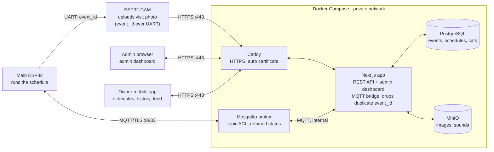
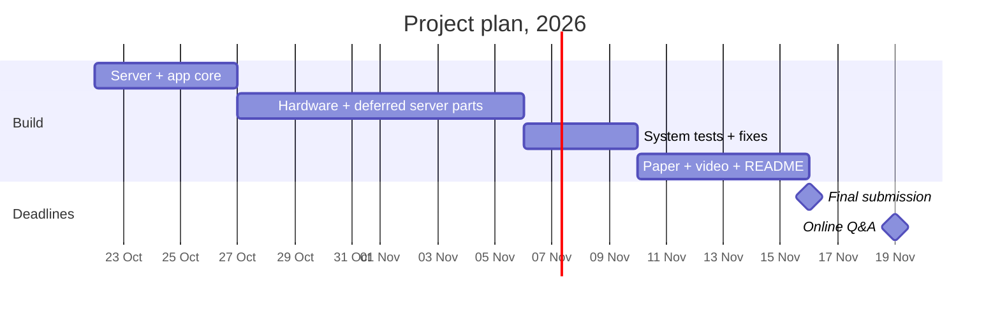

# Cat Feeder Server — Spec

> [!info] Sources
> Group05 Capstone Interim, Sections III–IV (label **Paper**), the AST01.41 Capstone Assignment Brief for the final phase (label **Brief**), and Sunny's red-pen review of v1 on 22 Oct 2026 (label **Review**). Rows marked **Added** are things the server needs but the paper does not say. Check those with Pisit before you build.

## Changes from the red-pen review (v1 → v2)

| # | Red-pen note | Change in this spec |
| --- | --- | --- |
| 1 | "Owner browser" → **Admin** browser; new box **Owner Mobile App** | Two clients now: admin dashboard (browser) and owner mobile app. Users get a `role` (Section 7) |
| 2 | ~~Identify cats from camera images~~ → **use RFID** | Cat ID is by RFID tag. The `cats` table is now required (Section 7) |
| 3 | **SERVER = NEXT.JS** — admin dash + server API; FastAPI crossed out | One Next.js app = REST API + admin dashboard + MQTT bridge (Section 4) |
| 4 | **Caddy** circled; static HTML dashboard crossed out | Caddy is the HTTPS proxy, with automatic certificates |
| 5 | Check time zone, use Thai time zone | Section 2: Thai time everywhere |
| 6 | REST API: "for mobile?" "use service or make own?" | Yes, the mobile app and admin dashboard both use this API. Built by us in Next.js, not a hosted service (Section 6) |
| 7 | Create test account; no email sending; just email + password | Seed accounts from `.env`; no email verification or reset emails (Section 7) |
| 8 | JWT expiry 60 minutes → **3 days** | JWT lasts 3 days (Section 8) |

## Decisions from the grill session (22 Oct 2026)

Terms are defined in `GLOSSARY.md`; decisions with reasons are in `docs/adr/`.

| Topic | Decision |
| --- | --- |
| Hosting | Docker Compose everywhere. Develop on the laptop; the **demo host is a VPS** (Proxmox dropped). Frozen from 6 Nov (Section 4) |
| Device address | Feeders connect to a **hostname**, never an IP; certs carry that name (Section 4) |
| Camera `event_id` | UART wire from the main ESP32 (ADR 0001) |
| Offline | No phone-to-feeder control; the physical button is the fallback (ADR 0002) |
| Clients | Owner app (mobile, already ~50% built) and admin dashboard (pages in the Next.js app). Both use REST only and poll every 5 s |
| API contract | `openapi.json` generated from the zod schemas, delivered first as a stub by ~24 Oct (Section 6) |
| Fake feeder | One TypeScript script that plays both boards, so nothing waits for hardware |
| Math | `analysis/analysis.ipynb` computes every paper number from the CSV export (Section 10) |
| Timeline | Server + app 22–26 Oct → hardware → tests → paper (Section 11) |
| Hostname | Free **DuckDNS** name (Section 4) |
| Pairing | Admin pairs in the admin dashboard; secrets shown once, go into the firmware's `secrets.h` (Section 8) |
| Schedule sync | Feeder reports its applied `schedule_version` in `status`; the owner app shows "Synced ✓" or "Waiting for feeder…" (Section 5) |
| Feeding sounds | Owner app → server (converted to MP3) → main ESP32 downloads and caches (Section 9) |
| Team | Sunny: server. Pisit: owner app. Both: hardware |

> [!warning] Update the paper too
> The interim paper names **FastAPI** (Abstract, Table 1, Table 2, Table 4, Section IV) and a "web/mobile application". The brief allows changing platform components, but the final manuscript must describe the system you really built. Replace FastAPI with Next.js in those places before 16 Nov.

## 1. Overview

The server is the **Platform layer** from the interim paper: Docker services for Mosquitto, a **Next.js** app (REST API + admin dashboard), PostgreSQL and MinIO, behind a Caddy HTTPS proxy. It stores schedules, feeding history, images and sounds. It does **not** decide when to feed: the ESP32 does that, so feeding still works when the Internet is down. When the Internet or the server is down, the owner uses the feeder's physical button; the owner app never talks to a feeder directly (ADR 0002).



Devices and people reach the server through two ports only: 8883 for the feeder, 443 for everything else. PostgreSQL and MinIO stay on the private network; the Next.js app is the one service that reaches them.

**Due:** final manuscript, demo video and repo link on **16 Nov 2026, 18:00 (Thai time)**. Online Q&A on **19 Nov 2026, 10:00–12:00**.

## 2. Time zone rule — Thai time everywhere

**Every part of the system uses Thai time: `Asia/Bangkok`, UTC+07:00.** No code does time-zone maths. Thailand has no daylight saving time, so `+07:00` never changes.

| Part | Setting | What you see |
| --- | --- | --- |
| Server host | `timedatectl set-timezone Asia/Bangkok` | `date` shows +07 |
| All containers | `TZ=Asia/Bangkok` in `docker-compose.yml` for every service | Logs show Thai time |
| PostgreSQL server | `command: postgres -c timezone=Asia/Bangkok -c log_timezone=Asia/Bangkok` | `SELECT now();` → `2026-11-02 07:00:03+07` |
| PostgreSQL database | `ALTER DATABASE catfeeder SET timezone TO 'Asia/Bangkok';` (in the init SQL) | Every connection gets Thai time, even from a new tool |
| Columns | `timestamptz`, new rows use `DEFAULT now()` | Values come back as `+07`; the DB makes the time, not JS |
| Next.js reads | Drizzle `timestamp('occurred_at', { withTimezone: true, mode: 'string' })` | Times stay as Thai-time strings; no JS `Date` in between |
| Next.js writes | One helper `nowTh()` = `formatInTimeZone(new Date(), 'Asia/Bangkok', "yyyy-MM-dd'T'HH:mm:ssXXX")` (`date-fns-tz`) | `"2026-11-02T08:15:00+07:00"` |
| ESP32 + ESP32-CAM | `configTzTime("ICT-7", "pool.ntp.org");` (POSIX string `ICT-7` = UTC+7) and the RTC set to Thai time | `localtime()` is Thai time |
| MQTT / REST payloads | ISO 8601 with `+07:00` | Same time on device, server, DB and app |
| Schedules | `"time": "07:00"` means 07:00 Thai time; `timezone` is always `"Asia/Bangkok"` | No offset maths on the ESP32 |
| Admin dashboard + mobile app | Show the API string as it is, or format with `timeZone: 'Asia/Bangkok'` | Same time on any phone or browser |
| CSV export | Times with `+07:00` | Section V analysis in Thai time |

> [!danger] The JavaScript trap
> `new Date().toISOString()` and `JSON.stringify(someDate)` always give **UTC** (`2026-11-02T01:15:00.000Z`). Never send a JS `Date` in JSON. Use strings from the DB (`mode: 'string'`) or `nowTh()`.

**Why `timestamptz` and not plain `timestamp`:** with the database time zone set to Bangkok, `timestamptz` gives you Thai time on every read, so you never convert. It also protects you from one hidden bug: if some code sends a time with a different offset (for example an ESP32 that forgot `configTzTime` and sends `Z`), PostgreSQL still saves the correct moment. A plain `timestamp` column would save it 7 hours wrong without any error.

**Input rule:** if a payload time has no offset (`2026-11-02T07:00:00`), the server treats it as Thai time. *Added.*

**Check after setup:**

```sql
SHOW timezone;      -- Asia/Bangkok
SELECT now();       -- ...+07
```

```bash
docker compose exec app date        # shows +07
docker compose exec db date         # shows +07
```

## 3. Scope

The server has 10 jobs.

| # | The server must | Source |
| --- | --- | --- |
| 1 | Log in a user (admin or owner) with email + password and return a JWT | Paper IV-C, Review |
| 2 | Save schedules and publish the newest set as a retained MQTT message | Paper III-C |
| 3 | Send a manual-feed command with a unique `command_id` | Paper III-B |
| 4 | Receive feeding events and reject a repeated `event_id` | Paper III-B, IV-D |
| 5 | Track online/offline state through retained status + Last Will | Paper III-B |
| 6 | Identify the visiting cat by its **RFID tag** (tag → cat name in `cats`) | Paper IV-A, Review |
| 7 | Accept image uploads from the ESP32-CAM and store them in MinIO | Paper IV-C |
| 8 | Store owner-recorded feeding sounds in MinIO | Paper Table 4 |
| 9 | Serve history, weights, cat, status and images to the **mobile app** and the **admin dashboard** | Paper IV-D step 9, Review |
| 10 | Pair and re-pair a feeder, and revoke old device credentials | Paper IV-C |

**The server must not:**

- Run the feeding scheduler. The ESP32 decides when to feed.
- Release extra food to correct a portion error.
- Use camera images to identify cats. Cat ID is RFID only; the photo is supporting evidence.
- Show the food eaten by one cat. With a shared bowl, the RFID tag only means "likely visitor".
- Trigger a missed feeding late. It only stores the `missed` event.
- Send emails (no verification, no password-reset mail). *Review.*

## 4. Deployment

One `docker-compose.yml` runs everything on one private network. Only two ports are open to the outside: **8883** (MQTT over TLS, for feeders) and **443** (HTTPS through Caddy, for the mobile app, the admin dashboard and the ESP32-CAM). Every service has `TZ=Asia/Bangkok` (Section 2).

| Service | Image | Port | Open to outside? | Persistent volume | Source |
| --- | --- | --- | --- | --- | --- |
| `mosquitto` | `eclipse-mosquitto:2` | 8883 (TLS) | Yes | config, password file, ACL, certs, data | Paper |
| `app` | Next.js (Node 20, `output: 'standalone'`) — REST API + admin dashboard + MQTT bridge | 3000 | Through Caddy only | — | Review |
| `db` | `postgres:16` | 5432 | No | `pgdata` | Paper |
| `minio` | `minio/minio` | 9000 API, 9001 console | No | `miniodata` | Paper |
| `caddy` | `caddy:2` | 80, 443 | Yes | `caddy_data` (certificates) | Review |

### Next.js app layout *(Added)*

| Part | Where in the code | Job |
| --- | --- | --- |
| REST API | `app/api/v1/**/route.ts` (Route Handlers) | All endpoints in Section 6 |
| Admin dashboard | `app/(admin)/**/page.tsx` | Feeders, live events, images, test results |
| MQTT bridge | `instrumentation.ts` → `register()` starts one `mqtt` (MQTT.js) client when the server boots | Subscribes to events + status; publishes schedules + commands |
| DB access | Drizzle ORM + `pg` | Tables in Section 7 |
| Media | `minio` (or `@aws-sdk/client-s3`) | Images and sounds |
| Validation | `zod` | Rejects bad payloads with `422` |
| Auth | `jose` (JWT) + `bcryptjs` or `argon2` | Section 8 |
| API contract | `@asteasolutions/zod-to-openapi` builds `openapi.json` from the same zod schemas | Section 6 |
| Fake feeder | `scripts/fake-feeder.ts` (MQTT.js + fetch) | Plays both boards: status + Last Will, schedule, commands, events, duplicates, outage, image upload |

- The MQTT bridge needs a **long-running Node server** (`next start` / standalone in Docker). It will not work on serverless hosting such as Vercel. Fallback if `instrumentation.ts` gives trouble: a small `worker` container from the same code (`node worker.js`).
- **Caddy** gets a free Let's Encrypt certificate automatically. It needs a **domain name** pointing to the server and ports 80 + 443 reachable. A real certificate matters because phones reject self-signed certificates in apps. A free DNS name (for example DuckDNS) is enough.
- **Hosts:** develop on the laptop (Apple Silicon, arm64) with the fake feeder; the **demo host is a VPS**. Proxmox is dropped, so the VPS is the "cloud" for the paper. From 6 Nov the demo host is frozen: real feeder, 30-cycle test, Section V benchmarks and video all run on it. *Added.*
- **Moving hosts:** every host runs `git pull && docker compose up --build` (never copy images: the laptop is arm64, a VPS is usually amd64). Copy only `.env` and the cert/CA files. Data from development is disposable.
- **Hostname, not IP:** feeders connect to a free **DuckDNS** name (for example `catfeeder-g05.duckdns.org`); the MQTT server certificate carries that name in its SAN. Moving hosts then means updating DNS, not reflashing firmware.
- **Local development:** plain `http://<laptop-ip>:3000`, no Caddy or certificates needed.
- `app` talks to `mosquitto` on internal port 1883 (not open outside). Feeders always use 8883 with TLS. *Added.*
- Secrets (DB password, JWT secret, MinIO keys, seed passwords) live in a `.env` file. Commit only `.env.example`.

## 5. MQTT spec

All topics follow `catfeeder/{device_id}/{message_type}`, use QoS 1, and run over TLS on port 8883. The four topics come straight from Paper Table 3.

| Topic | Publisher → Subscriber | Retained | Purpose |
| --- | --- | --- | --- |
| `catfeeder/feeder01/schedule/set` | Server → ESP32 | Yes | Newest full schedule set |
| `catfeeder/feeder01/command/feed` | Server → ESP32 | No | One manual feed |
| `catfeeder/feeder01/event/feeding` | ESP32 → Server | No | One feeding record |
| `catfeeder/feeder01/status` | ESP32 → Server | Yes | Online/offline (Last Will = offline) |

### Access control list (Mosquitto `acl_file`)

If each feeder's MQTT username is its `device_id`, one `%u` pattern covers every feeder. *Added.*

```
# server (Next.js MQTT bridge) account
user backend
topic readwrite catfeeder/#

# every feeder: username = device_id
pattern read  catfeeder/%u/schedule/set
pattern read  catfeeder/%u/command/feed
pattern write catfeeder/%u/event/feeding
pattern write catfeeder/%u/status
```

### Payloads (JSON)

Field names are *Added*; the fields themselves come from Paper IV-A and IV-D. All times are Thai time with `+07:00` (Section 2).

**schedule/set** — send the **whole** list, not one schedule. A retained topic keeps only the last message, so a single schedule would erase the others.

```json
{
  "schedule_version": 12,
  "timezone": "Asia/Bangkok",
  "schedules": [
    {"schedule_id": "morning-feed", "time": "07:00", "portion_g": 40, "sound_id": "call-01", "enabled": true},
    {"schedule_id": "evening-feed", "time": "18:00", "portion_g": 40, "sound_id": "call-01", "enabled": true}
  ]
}
```

**command/feed**

```json
{"command_id": "cmd-3f9c2a", "portion_g": 40, "sound_id": "call-01", "issued_at": "2026-11-02T08:15:00+07:00"}
```

**event/feeding**

```json
{
  "event_id": "feeder01-0f7e1c",
  "device_id": "feeder01",
  "trigger": "schedule",
  "schedule_id": "morning-feed",
  "command_id": null,
  "scheduled_at": "2026-11-02T07:00:00+07:00",
  "occurred_at": "2026-11-02T07:00:03+07:00",
  "target_portion_g": 40,
  "bowl_before_g": 12.4,
  "bowl_after_g": 50.9,
  "rfid": {"result": "tag", "tag_id": "E200001A"},
  "image_expected": true,
  "result": "ok",
  "device": {"rssi": -61, "fw": "0.3.0", "queue_len": 0}
}
```

- `trigger`: `schedule` | `remote` | `button`
- `rfid.result`: `tag` | `unknown` | `multiple` (Paper objective 5). The server looks up `tag_id` in `cats` to show the cat's name.
- `result`: `ok` | `jam` | `missed` | `error`
- The numbers above are example values, not measurements.

**status** — the ESP32 publishes `{"state": "online", "schedule_version": 12, "fw": "0.3.0"}` (retained) after it connects, and again every time it applies a new schedule set. Its Last Will is `{"state": "offline"}` (retained, QoS 1).

The server compares the reported `schedule_version` with `feeders.schedule_version`: equal means the feeder is **synced**; lower means it has not received the newest schedules yet. The owner app shows "Synced ✓" or "Waiting for feeder…".

## 6. REST API

**Who uses it:** the **owner mobile app** and the **admin dashboard** both call this API, plus the ESP32-CAM and the main ESP32 for device routes.

**Use a service or make our own? → Make our own, in Next.js.** A hosted backend (Firebase, Supabase Cloud) would move the database and auth off your server. Then the paper's Docker platform, the Mosquitto ACL tied to our users, and the Section V benchmarks on your own host would no longer describe the real system. Next.js Route Handlers are small enough to build in the time left.

Base path `/api/v1`, JSON over HTTPS. User routes need `Authorization: Bearer <JWT>`; device routes need the device token. All times are Thai time with `+07:00`.

| Method | Path | Caller | What it does | Source |
| --- | --- | --- | --- | --- |
| POST | `/auth/login` | Mobile app, admin | Email + password → JWT (3 days) | Paper IV-C, Review |
| GET | `/me` | Mobile app, admin | Who am I + role | Added |
| GET | `/feeders` | Mobile app, admin | Owner: my feeders. Admin: all feeders. With online state | Added |
| POST | `/feeders/{id}/pair` | Admin | Body: `owner_id`. Assign the owner, make a new MQTT password + device token (shown once), revoke old ones | Paper IV-C |
| GET | `/feeders/{id}/schedules` | Mobile app, admin | List schedules + current version | Added |
| POST | `/feeders/{id}/schedules` | Mobile app, admin | Create/update → `201` + `schedule_version` | Paper III-C |
| DELETE | `/feeders/{id}/schedules/{schedule_id}` | Mobile app, admin | Remove, then republish the set | Added |
| POST | `/feeders/{id}/commands/feed` | Mobile app, admin | Manual feed → `202` + `command_id` | Paper III-B, IV-D |
| GET | `/feeders/{id}/commands/{command_id}` | Mobile app, admin | Manual feed status: `sent` or `done` (+ `event_id`) | Added |
| GET | `/feeders/{id}/events?from=&to=&since=` | Mobile app, admin | Feeding history with cat name. `from`/`to` filter `occurred_at` (history); `since` filters `received_at` (polling, so late events from an outage still appear) | Paper IV-D |
| GET | `/feeders/{id}/events.csv` | Admin | Export for the Section V analysis | Added |
| GET | `/feeders/{id}/status` | Mobile app, admin | Online/offline, last seen, `synced` (true/false) + both schedule versions | Added |
| GET/POST | `/cats` | Mobile app, admin | List cats; register a cat with its RFID tag | Review |
| GET | `/feeders/{id}/sounds` | Mobile app | List feeding sounds (to pick one for a schedule) | Added |
| POST | `/feeders/{id}/sounds` | Mobile app | Upload a recorded sound | Paper Table 4 |
| GET | `/media/{media_id}` | Mobile app, admin | Image or sound, streamed from MinIO | Added |
| POST | `/devices/{id}/images` | ESP32-CAM | JPEG + `event_id` → MinIO | Paper IV-C |
| GET | `/devices/{id}/sounds/{sound_id}` | Main ESP32 | Download a sound to cache locally | Added |
| GET | `/admin/users` | Admin | List users, to pick the owner when pairing | Added |
| GET | `/admin/events?result=&feeder=` | Admin | All feeding events, filterable, with raw JSON | Added |
| GET | `/admin/stats` | Admin | Duplicate count, failed events count | Added |

- Manual feed returns **`202 Accepted`**, not `201`: the server only sent the command. The feed is "done" when an event with that `command_id` arrives.
- Errors: `401` no/expired token · `403` not your feeder, or not an admin · `404` not found · `422` bad time or portion.
- Live updates: the owner app and admin dashboard poll every 5 s while a screen is open (`GET /feeders/{id}/events?from=<last seen>`). No WebSocket.
- **The contract is `openapi.json`**, generated from the zod schemas with `zod-to-openapi` and committed to the repo. The app developer builds against it. It is delivered first as a stub (every route, real zod schemas, hard-coded example data) by about 24 Oct; then each route gets real logic without changing its shape. A hand-written `docs/api.md` guide may follow later.

## 7. Database (PostgreSQL)

Nine tables. Media files stay in MinIO; PostgreSQL keeps only the object key (Paper Table 4). All time columns are `timestamptz`, and the database time zone is `Asia/Bangkok`, so every value reads back in Thai time (Section 2).

| Table | Key columns | Notes |
| --- | --- | --- |
| `users` | `id`, `email` UNIQUE, `password_hash`, `role` (`admin` / `owner`), `created_at` | Email + password only; no email verification (Review) |
| `feeders` | `id` (e.g. `feeder01`) PK, `owner_id` FK, `name`, `schedule_version`, `device_token_hash`, `paired_at` | Owner link = the access check (Paper IV-C) |
| `cats` | `id` PK, `owner_id` FK, `name`, `rfid_tag` UNIQUE | Required now: cat ID is by RFID (Review) |
| `device_status` | `feeder_id` PK, `state`, `last_seen`, `fw`, `applied_schedule_version` | Updated from the `status` topic |
| `schedules` | PK (`feeder_id`, `schedule_id`), `time`, `timezone` (always `Asia/Bangkok`), `portion_g`, `sound_id`, `enabled` | Whole set is published on every change |
| `commands` | `command_id` PK, `feeder_id`, `portion_g`, `sound_id` NULL, `issued_by`, `issued_at`, `done_event_id` | Links a manual feed to its event |
| `feeding_events` | `event_id` PK, `feeder_id`, `trigger`, `schedule_id`, `command_id`, `scheduled_at`, `occurred_at`, `received_at` DEFAULT `now()`, `target_portion_g`, `bowl_before_g`, `bowl_after_g`, `rfid_result`, `rfid_tag`, `result`, `raw` JSONB | PK on `event_id` = duplicate protection. Cat name = join `cats` on `rfid_tag` |
| `media` | `id` PK, `feeder_id`, `kind` (image/sound), `object_key`, `event_id` NULL, `sound_id` NULL, `content_type`, `created_at` DEFAULT `now()` | Image joins its event by `event_id` |
| `duplicate_events` | `id` PK, `event_id`, `feeder_id`, `received_at` DEFAULT `now()` | One row per rejected duplicate; the count is the objective 4 result |

### Test accounts (seed) — *Review*

A seed script (`npm run seed`) creates the test data from `.env`, and runs automatically when the database is empty on first start. `npm run reset` wipes and reseeds. Besides the accounts below it adds two schedules and about 20 example events covering every `result` and `rfid.result`, so the owner app shows realistic screens without hardware. No emails are ever sent.

| Account | From `.env` | Role | Owns |
| --- | --- | --- | --- |
| Admin | `SEED_ADMIN_EMAIL`, `SEED_ADMIN_PASSWORD` | `admin` | Sees all feeders |
| Test owner | `SEED_OWNER_EMAIL`, `SEED_OWNER_PASSWORD` | `owner` | `feeder01` + 2 test cats with RFID tags |

## 8. Security

User identity and device identity stay separate (Paper IV-C). Each rule below says how to build it.

| Rule | How to build it | Source |
| --- | --- | --- |
| Passwords are salted hashes | `bcryptjs` or `argon2` | Paper |
| Login gives a JWT | HS256 with `jose`, **3-day expiry**, secret in `.env` | Paper (expiry: Review) |
| Owner touches only own feeders; admin sees all | One helper `requireFeeder(user, feederId)` used in every `/feeders/{id}` route: allow if `role = admin` or `feeders.owner_id = user.id` | Paper (admin: Review) |
| Admin-only actions | Pairing and CSV export check `role = admin` | Added |
| One MQTT login per feeder | `mosquitto_passwd` file, `allow_anonymous false`, username = `device_id` | Paper |
| Feeder only sees its own topics | ACL in Section 5 | Paper |
| Feeder checks the server | Own CA for MQTT; put its cert in ESP32 firmware; the server cert's name/IP must match what the ESP32 connects to | Paper (CA: Added) |
| HTTPS for app, dashboard, camera | Caddy with an automatic Let's Encrypt certificate | Review |
| ESP32-CAM upload needs a device token | Random token; store only its hash in `feeders` | Paper |
| Pairing puts secrets on the boards | Admin clicks "Pair" in the admin dashboard and picks the owner; the server shows the MQTT password + device token **once**; paste them (and the home Wi-Fi name/password) into the firmware's `secrets.h` (never committed) and flash both boards. Phone-based setup is future work (ADR 0002) | Added |
| Re-pair revokes old credentials | Rewrite the password file, then send `SIGHUP` to Mosquitto; rotate the token. A still-connected board may keep its session until it reconnects, so restart Mosquitto (or the board) to force it off | Paper (reload: Added) |
| No secrets in payloads, file names or logs | Image key = `images/{feeder}/{event_id}.jpg`; never log tokens | Paper |
| DB and MinIO stay private | No `ports:` for `db` and `minio` in Compose | Paper |

> [!note] About the 3-day JWT
> The paper says "short-lived JWT". Three days is fine for a prototype, but a stolen token works for three days, and you cannot cancel it early. In the final paper, write "a JWT that expires after three days" instead of "short-lived", and name this as a limitation.

Note: TLS certificates and JWT expiry checks depend on a correct clock. With NTP and Thai time on every device and container, they stay in agreement.

## 9. Server logic rules

These 9 rules are the "brain" of the Next.js MQTT bridge and API. Rules 1–4 and 7 come from the paper; the rest are *Added* to make them work.

1. **Event ingest.** Subscribe to `catfeeder/+/event/feeding`. Check that the `device_id` in the topic equals the one in the payload. Then `INSERT … ON CONFLICT (event_id) DO NOTHING`. When nothing was inserted, add a row to `duplicate_events`: that count is your duplicate-prevention result.
2. **Schedule change.** Save the row → add 1 to `schedule_version` → publish the **whole** set to `schedule/set`, retained, QoS 1. Reply `201`. This means "accepted", not "the feeder has it" (Paper III-C).
3. **Manual feed.** Make a UUID `command_id`, save it, publish to `command/feed`, **not** retained, with `issued_at = nowTh()`. Reply `202`. When an event with the same `command_id` arrives, fill `commands.done_event_id`.
4. **Status.** Subscribe to `catfeeder/+/status` and update `device_status` (state + last seen).
5. **Images.** The ESP32-CAM uploads with the `event_id`. The image may arrive before or after its event (for example after an outage), so link them at read time by `event_id`, never by arrival order.
6. **Late events.** Offline events arrive later with their original `occurred_at`. `received_at` is filled by the DB (`DEFAULT now()`). `received_at − occurred_at` is your sync delay for objective 3. Both are Thai time, so the subtraction needs no conversion.
7. **Feeding sounds.** The owner records a sound in the owner app and uploads it (`POST /feeders/{id}/sounds`). The server converts it with `ffmpeg` to one format the ESP32 can play (MP3, mono, 8–16 kHz), stores it in MinIO and returns a `sound_id`. The main ESP32 downloads a sound the first time a schedule or command names a `sound_id` it does not have, and caches it on flash/SD. The phone never sends the file to the feeder directly (ADR 0002). *Added.*
8. **Missed feedings.** Store events with `result = missed`. The server never triggers a feed on its own (Paper IV-D).
9. **Old commands.** A QoS 1 command can wait in the broker while the feeder is offline and then arrive late. Use a clean MQTT session on the ESP32, and let it ignore a command older than 60 s (compare `issued_at` with its own Thai-time clock). Otherwise an old button press could release food hours later.

## 10. Tests, benchmarks and repo

The server must record enough data to prove the paper's 5 objectives, and the brief adds benchmarks, a live demo and a repo.

| Check | What the server provides | Pass target | Source |
| --- | --- | --- | --- |
| Dispensing reliability and accuracy | 30 events with `bowl_before_g`, `bowl_after_g`, `target_portion_g`, `result` in the CSV export | ≥ 27 of 30 `ok`; mean absolute error ≤ 10% | Paper obj. 1 |
| Schedule timing | `scheduled_at` vs `occurred_at` (both Thai time) | Within ±1 min | Paper obj. 2 |
| Offline feeding + sync | All outage events arrive later, no repeat feed; `received_at` shows the delay | 100% of events uploaded | Paper obj. 3 |
| One record per event | Count of rejected duplicate `event_id`s | 0 duplicate rows | Paper obj. 4 |
| RFID results | `rfid_result` stores `unknown` / `multiple` honestly; known tags show the cat's name | No forced cat ID | Paper obj. 5 |
| Time zone | One event checked on ESP32 serial log, DB row, admin dashboard and mobile app | Same Thai time in all four | Added |
| RFID read range | Nothing: bench test by hand (tag at 1, 2, 3, 5, 8 cm × 20 tries), results in `analysis/rfid_range.csv` | Success rate per distance; max range with ≥ 95% reads | Added |
| Section V benchmarks | Run on the demo host (VPS): `sysbench` (CPU, memory), `dd` (disk), `iperf3` (network). Keep the raw output | Report your measured numbers | Brief |
| Live demo in video | Sensor changes → broker → admin dashboard / mobile app updates on screen | Real data, not slides (40% of the system mark) | Brief |
| Repo + README | How to run: `.env.example`, domain + Caddy, `docker compose up`, `npm run seed`, a test command | Someone else can start it (10%) | Brief |

The owner app and admin dashboard poll every 5 s, so the live demo shows the update without a reload.

**The math for the paper** lives in `analysis/analysis.ipynb` (Python + pandas). The server only records data; the notebook reads the CSV export, the duplicate count, `analysis/rfid_range.csv` and the raw benchmark output, and computes every number and chart:

- Dispensed = `bowl_after_g − bowl_before_g`; error % = |dispensed − target| / target; mean absolute error; success rate
- Timing delay = `occurred_at − scheduled_at`; mean, max, % within ±60 s
- Sync delay = `received_at − occurred_at`; % of outage events uploaded
- Duplicates rejected vs extra rows stored (must be 0)
- RFID result counts; read success rate vs distance

## 11. Build order

Server and owner app first, then hardware, then tests, then the paper. The server is built against the fake feeder, so nothing waits for hardware. If the hardware slips, cut the camera and image upload first, never feeding and events.



1. **Server + app core** (22–26 Oct) — first the stub API, so `openapi.json` reaches the app developer by about 24 Oct. Then real logic: Compose with `TZ=Asia/Bangkok`, Mosquitto + ACL, PostgreSQL with the Bangkok time zone, login + JWT with owner/admin roles, feeders, cats, schedules (retained publish), manual feed, MQTT bridge with event ingest + duplicate check, status + Last Will, history + CSV export, seed data, fake feeder, admin dashboard. Image and sound routes exist as stubs. The app developer switches from fake data to the real API.
2. **Hardware + deferred server parts** (27 Oct–5 Nov) — main ESP32 + ESP32-CAM (UART for `event_id`, `configTzTime("ICT-7", ...)`), pointed at the VPS hostname. Server: MinIO image/sound upload and download, pairing and re-pairing, VPS setup with Caddy + Let's Encrypt on 443 and our own CA on 8883.
3. **System tests + fixes** (6–9 Nov), on the frozen demo host — 30-cycle test, outage test, time zone check, RFID range bench test, `sysbench`/`dd`/`iperf3` with raw output saved.
4. **Paper + video + README** (10–15 Nov) — run `analysis/analysis.ipynb`, write and explain the math, record the 5–7 min demo, write how to run the platform, update the paper (FastAPI → Next.js, JWT wording, Proxmox → VPS).

## 12. Open questions

None of these block the 26 Oct server core.

- [x] **Mobile app: native or web?** Decided: the owner app is already ~50% built as a separate mobile app; it uses this API.
- [x] **Domain name:** free DuckDNS.
- [x] **How does the ESP32-CAM get the `event_id`?** UART wire from the main ESP32 (ADR 0001).
- [x] **How does the main ESP32 get the owner's sound file?** Owner app uploads → server converts to MP3 → ESP32 downloads by `sound_id` and caches (Section 9, rule 7).
- [x] ~~Does CT 108 allow Docker?~~ Proxmox dropped; the demo host is a VPS.
- [x] **Should the ESP32 report its applied `schedule_version`?** Yes, in its status message (Section 5).
- [x] ~~Does Proxmox count as "cloud"?~~ Moot: the VPS is the cloud.
- [x] **Pairing flow:** admin pairs in the admin dashboard; secrets go into `secrets.h` and are flashed (Section 8).
- [x] **Who builds what?** Sunny: server (Next.js API, MQTT bridge, admin dashboard, Docker, VPS). Pisit: owner app. Both: hardware. Every member must speak in the video and answer questions.
- [x] **Who writes the paper and the analysis notebook?** A loose split by area, not strict: Sunny leads platform layer, benchmarks and the analysis notebook; Pisit leads the application layer; both write edge layer, test results, discussion and conclusion.
